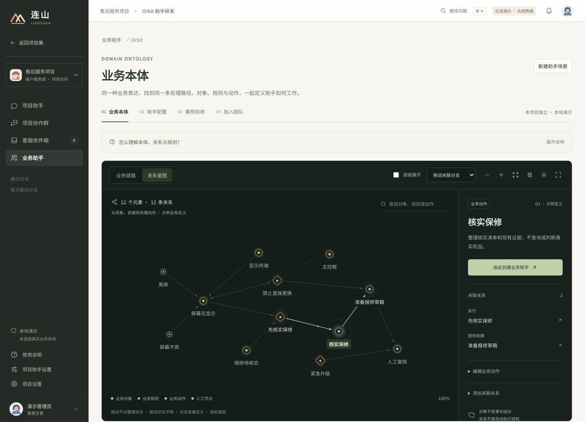
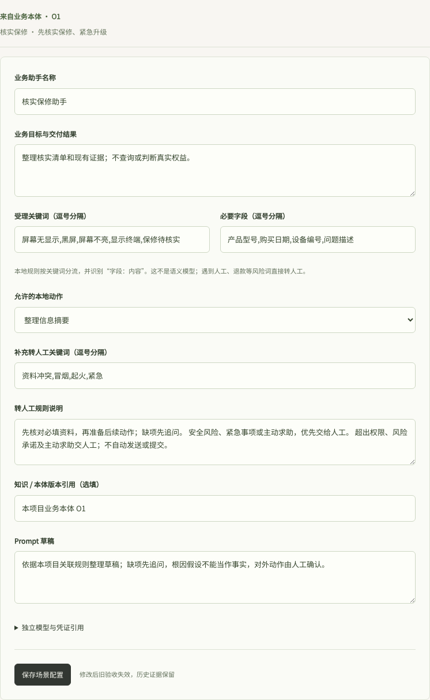
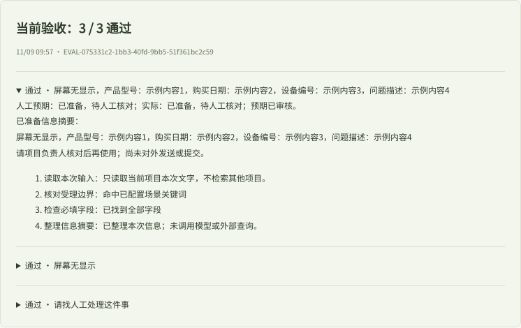
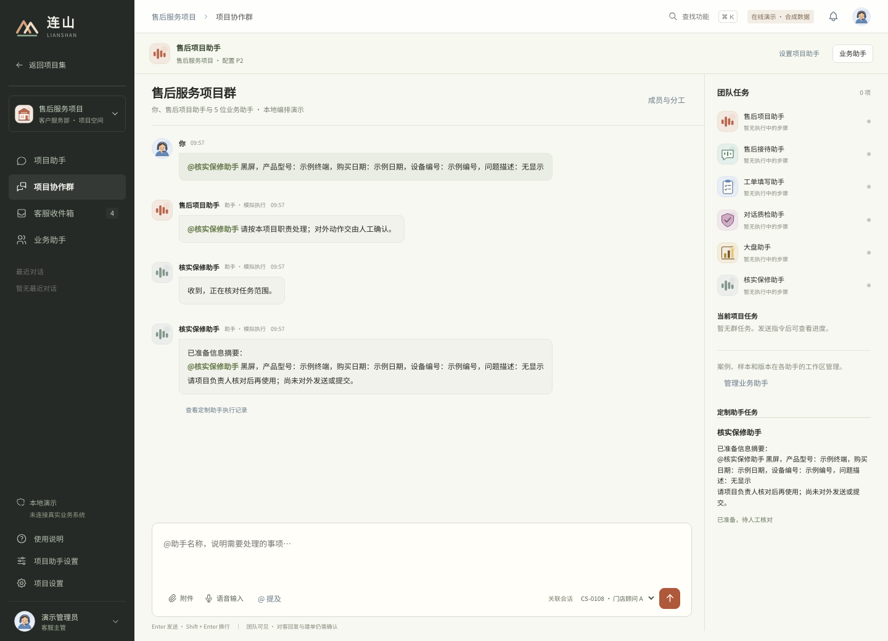

# 连山 · AI 业务助手平台

连小山是连山的协调助手，在业务协作群中接收目标、分派任务并汇总结果；Orbit 统一管理流程与业务定义，经案例验收后进入本地任务执行检查。客服是首个业务场景，保留自助解答、带记录转人工、工单处理、回告与确认解决的完整演练。

[打开客服工作台](https://ethen-chuan.github.io/lianshan-agent-platform/?project=AFTERSALES#workspace) · [五分钟使用指引](https://ethen-chuan.github.io/lianshan-agent-platform/about.html) · [功能取舍与待打通清单](notes/SERVICE_FOCUS_ITERATION.md)

> **v0.2.0 · 可交互演示，非生产系统。** 下方为首次发布时的产品实机截图，使用独立演示会话与合成数据；公开静态版不调用大模型，也未接通线上客服渠道或 CRM/QMS。源码和演示网页均可免登录查看。

## 2026-11-11 更新 · 业务设计与可拖动关系图

- **同一份定义，两种图。** 星状图围绕对象查看关联，卡片图按业务类型阅读；两者都可直接拖动节点和空白画布，连线跟随变化。位置调整不修改业务定义或助手版本。
- **文字不再被挤压。** 节点根据标题长度留出高度，长标题完整换行，字段摘要另起一行；工具栏增加缩放比例、适应画布与恢复排布。
- **描述业务，再确认设计。** 在本地服务连接模型后，文字／语音描述可整理为对象、字段、规则、动作和关系，确认后创建带头像的同一位助手，继续微调、测试与启用。
- **共享定义与流程统一到 Orbit。** 保留定义目录、旧流程编辑与历史版本，不新增重复入口；工单记录归工单填写助手。
- **连小山协作、客户模型对话。** 本地服务支持受限模型任务和连续问答，使用者需自行配置模型并确认数据范围与费用；不会自动操作真实业务系统。

| 运行方式 | 可以体验 | 不包含 |
| --- | --- | --- |
| GitHub Pages | 关系图拖动与切换、手动定义、流程编辑、配置与本地案例演练 | 模型调用、语音识别、真实渠道与业务提交 |
| 本机 Node 服务 | 上述功能，以及配置模型后的业务设计、协作与客户问答 | 生产托管、自动审批、真实建单与消息外发 |

验证与限制见 [本次图谱升级](notes/ORBIT_MAP_INTERACTION_ITERATION.md)。本轮自动检查覆盖交互与数据边界；尚未完成新版实机视觉验收及真实付费模型验收。此前迭代文档中的“未推送”描述的是当时状态，不代表本次发布范围。

实现说明：[描述到助手](notes/ORBIT_BUSINESS_DESIGN_ITERATION.md) · [统一业务设计](notes/ORBIT_UNIFIED_ITERATION.md) · [模型协作](notes/SUPER_AGENT_ITERATION.md) · [客户模型对话](notes/CUSTOMER_MODEL_ITERATION.md) · [发布记录](notes/RELEASE.md)

## 产品界面

以下五张是首版的真实演示截图，保留用于说明产品流程，不代表本次更新后的外观。最新界面以在线演示为准。

### 01 · 业务本体与动作定义

当前本地版统一从左侧「Orbit / 业务设计」进入。用文字／语音描述业务，旁边预览模型整理的对象、字段、规则和关系；星状图聚焦对象关联，卡片图分层阅读，定义目录用于微调。确认设计即创建带头像和配置的助手，后续测试的是这同一位助手。下图为首次发布时的入口布局，不是最新本地版截图。



*支持关系星图与业务链路切换、节点拖动、搜索、渐进展开和动效暂停。截图为实际界面；动画可在在线演示中体验。*

### 02 · 助手配置

由业务动作带入字段与规则，再定义受理关键词、必要信息、允许动作和转人工条件。业务目标、版本引用与 Prompt 草稿集中维护，保存配置不等于生产发布。



### 03 · 案例验收

人工确认每条案例的预期，再执行本地验收。结果同时保留输入、预期、实际输出和处理步骤；未确认、失败或过期的验收不能用于加入团队。



*图中的「3 / 3 通过」仅对应这三条演示案例的本地规则验收，不代表模型准确率或生产效果。*

### 04 · 版本快照

人工确认后加入本项目团队，记录配置快照与验收引用。后续修改保存为新版本，已验收的历史记录保持不变。


### 05 · 团队协作与结果核对

在协作群中 @ 核实保修助手，使用示例信息完成受理与摘要准备。侧栏展示团队角色和定制助手任务，结果可继续查看执行记录；不会自动向客户发送或向业务系统提交。



截图记录与公开范围见 [产品图说明](notes/PRODUCT_GALLERY.md)。上线验收结果见 [发布记录](notes/RELEASE.md)。

## 页面入口

- 根页面：项目选择与整理。
- `?project=AFTERSALES#workspace`：售后项目默认入口，接待客户并处理工单。
- `?project=AFTERSALES#customer`：左侧「客户体验 · 模拟」；本机服务版支持模型对话，预设场景在「流程回归」。交接后使用同一条本地客服会话，不连接真实客户渠道。
- `?project=AFTERSALES#tickets`：工单填写助手内的工单记录，保留旧地址，不再单列侧栏；`#knowledge` 仍为独立知识库。
- `?project=AFTERSALES#agents`：售后项目的业务助手，可进入填单助手查看工单与配置。
- `?project=AFTERSALES#ontology`：兼容旧地址，转入 Orbit 内的「业务定义」，不再是独立侧栏功能。
- `?project=AFTERSALES#orbit`：统一「Orbit / 业务设计」入口；业务描述、流程预览、共享定义、配置与验收。
- `?project=AFTERSALES&design=definitions#orbit`：直接打开同一工作台内的「业务定义」，刷新后仍停留在该视图。
- `?project=AFTERSALES#settings`：接入与数据设置，以及默认收起的实验与旧版记录。
- `?project=AFTERSALES#group`：业务协作入口，本机服务版默认进入连小山模型协作；「规则演练与旧记录」保留原售后协作群、定制助手与验收记录。
- `?project=AFTERSALES#manager`：兼容旧链接，进入同一个协作工作台；历史独立对话仍可查看。
- `about.html`：面向访客的使用说明与能力边界。

## 产品定位

连小山负责受理、分派和汇总；业务助手负责具体业务；Orbit 负责研发这些助手。Harness 是任务执行约束层，不是新增的一位助手或一张业务页面。

入口叫「业务协作」，售后项目中的群名叫「售后协作群」。可直接 `@连小山`，也可 `@具体助手`；原有 `@Super Agent`、`@项目助手` 等称呼仍兼容。已有任务、消息、授权和验收版本不改写，用户自定义的协调助手名称保留。业务协作以群聊为主要入口；模型任务与规则演练记录分开，避免将预置过程误认为真实模型执行。

客户服务主路径为：**客户咨询 → 处理或转人工 → 必要的业务操作 → 回告 → 结果证据**。遇到新业务规则时，才进入 **定义与配置 → 案例验收 → 版本与回归**；配置完成不代表已接入客服运行。

| 能力 | 本版本已实现 | 边界 |
| --- | --- | --- |
| 业务本体 | 对象、关系、规则、动作；关系星图/业务链路；搜索、拖动、渐进展开、缩放与动效暂停 | 节点是示例业务定义，不是已批准的企业政策；原因假设不是确认根因 |
| 助手研发 | 从动作带入字段、规则和人工处理条件；保存配置；案例预期确认与本地验收 | 正常、缺项、转人工三类都须通过；未确认、失败或过期验收不能纳入本地团队 |
| 版本与执行 | 冻结本体/配置与运行规则；验收和运行共用字段、风险、动作检查；补充轮次、回执与人工核对留痕 | 仅本地草稿；文字规则和任意画布分支未自动执行；生产发送与建单未接入 |
| 调度与协作 | 一个协作工作台；统一任务引用、结果审核、失败重试；本地并行数可配置 | 共享信息不等于操作授权；不代表生产吞吐、多用户同步或服务端鉴权 |
| 售后服务 | 客户自助演练、带完整上下文转人工、接待、工单草稿、质检与人工确认 | 只保存本地演练；准备完成、客户演练确认与真实业务解决分开记录 |
| 客户模型对话 | 本机服务代理官方模型接口；多轮对话、已发布知识匹配、来源显示、取消与手动重试 | 需自行配置密钥和授权；仅售后接待助手，不执行业务工具；上线前还需真实模型验收及服务端鉴权 |
| 连小山模型协作 | 协调与执行分离、任务独立资料、SQLite 持久化、并发队列、停止/恢复、幂等接收、人工核对 | 仅受限草稿任务；本机单一可信操作员，不是企业多租户授权；任意工具和主动监听未接入 |
| 分析与改进 | 固定样本问数、问题 Top 5、性能口径、执行 Trace、失败案例与回归样本 | 不是实时经营成绩、自动根因分析或自动模型训练 |

## 五分钟体验

1. 选择售后项目，从左侧「客户体验 · 模拟」进入，切换到「流程回归」，选择设备报修。要试自由问答，请按下方说明配置模型。
2. 输入示例信息，如“A1 软件版本 V2.3.1”，携带记录转人工，再打开关联会话。
3. 人工接管，核对资料；从这条会话创建工单，缺项补齐并人工确认后才提交本地模拟单据。
4. 回复客户，或保存工单状态后回告。在工作台打开关联客户预览，可以看到客服消息；内部备注不显示。
5. 客户明确确认后，原会话记录解决证据；如果继续反馈未解决，原会话重新进入处理，不重复建会话。工单记录在「业务助手 → 工单填写助手」中查看。
6. 需要多助手处理时进入业务协作群；扩展业务从左侧 Orbit 进入。验收后的字段与风险约束参与本地执行，任意画布分支尚未成为客服执行引擎。

要体验规则如何拦住任务，可从业务协作侧栏打开“体验规则检查示例”，完成案例确认与发布，再省略一个必要字段发起任务；任务详情会显示未调用动作，并可补齐后继续原任务。示例不会替用户自动批准。

## 开发检查

- `npm run test:harness`：针对任务规则、协作和客服闭环的回归检查。
- `npm run check`：重新构建并运行全量测试，失败即停止，不自动部署。
- 修改编译或执行语义时同步更新运行器版本，要求重新验收；旧快照不得静默改写。

## 本地运行

使用 Node.js 22.13.0 或更高版本，需内置 `node:sqlite`；工程没有第三方运行依赖。本轮实际测试环境为 Node.js 25.9.0，未在 22.x 下重跑验收。

```sh
npm start
```

本地完整原型默认只监听 `127.0.0.1:4333`。若端口已有旧版本运行，请用另一个端口，不要直接终止原进程：

```sh
PORT=4342 npm start
```

在「客户体验 → 模型对话 → 配置模型」选择服务商、填写账号可用的文本模型 ID 与 API Key，保存后关闭配置；新建对话，确认数据范围与费用后发送脱敏问题。单独的「测试连接」只验证连通性，不是使用对话的必经步骤。密钥只在服务进程内存中保存，重启后需重新输入；请勿把密钥发到聊天、知识库或代码中。

客户模型对话按会话授权；连接更换、刷新页面或新建会话后重新确认。独立连接测试仍需逐次授权。不要将本地服务直接改成公网监听。

### 连小山模型协作

1. 打开 `http://127.0.0.1:4342/?project=AFTERSALES#group`，在「团队与模型」分别配置连小山及填单/接待/复核助手；至少有一位业务助手启用且获本项目授权。
2. 新建任务，按需选择客户会话、已发布知识和 Orbit 已验收定义，核对发送资料。默认不携带客户记录。
3. 输入目标，确认本轮资料及费用后发送；每轮最多一次协调请求和三次业务助手请求。助手输出按真实模型返回展示，失败不回退成预设答案。
4. 缺项在原任务补充；草稿可核对，失败或重启中断需人工恢复。停止不会撤销已发出的模型费用。
5. 浏览器关闭后，本机服务仍运行即可继续；服务/电脑关闭会中断。任务数据库在 `work/super-agent/tasks.sqlite`，与浏览器里的旧记录分开保存；不同端口的旧浏览器数据不会自动迁移。

任务数据库包含输入、所选资料和结果，默认仅当前操作系统用户可读写；不要提交、上传或随截图公开。当前最多 100 项任务、4000 条事件后停止新增处理，仍可核对或停止任务；尚无归档界面。已接收任务的资料保持快照，停用知识不会自动撤回已经发出的内容，需要手动停止并新建任务。模型连接只存进程内存，服务重启后需重新配置。

### 描述生成流程与业务本体

- 在 Orbit 的「描述业务」中连接连小山的模型，输入业务目标、处理条件与人工边界；模型返回流程草稿，核对修改前后再采用。没有模型连接时不能生成，不使用预设流程替代。
- 流程节点显示 01、02 等序号，可以直接说“修改第 3 步”。布局调整不改变编号，增删步骤后会重新编号。语音仅在支持的浏览器中转成待核对文字，不自动发送。
- Ontology 默认展示定义目录、必要字段、关系与动作。它统一“是什么、需要什么、允许做什么”；Orbit 负责“先做什么、后做什么”。例如，报修定义提供型号与问题描述，保修规则要求购买日期与设备编号，流程再安排收集、核对和交给人工的顺序。
- 采用生成草稿后，所选定义才记录为流程参考。引用页区分生成参考与已保存的字段规则快照；定义变化会提示复核，不直接改写旧版本。没有引用就明确显示尚未影响助手。
- 案例试跑是模型推演，不提交真实工单，不自动算作验收通过。保存助手草案后仍需审核案例、验收和发布；模型请求每次确认资料范围与费用。
- 保存后可从设计页继续配置或审核案例；同一版流程不重复创建草案。案例试跑的授权在案例输入框旁，修改案例或引用后需重新确认。

实现和限制见 [本轮说明](notes/PROMPT_ORBIT_ONTOLOGY_ITERATION.md)。

## 构建与预览在线版

```sh
npm run build
npm test
npm run preview
```

静态预览默认使用本机 `4340` 端口。构建只从 HTML 引用中提取白名单 CSS/JS，加上使用说明和第三方许可，输出到 `site/`，并生成内容相同、随 Git 提交的 `docs/` 供 Pages 发布。不会把后端、开发文档、密钥、简历、浏览器会话或工作目录加入站点。不要直接编辑 `docs/`，它会被下一次构建重新生成。

在线模式显式禁用模型密钥接收及浏览器语音识别，HTML 中的 CSP 禁止应用发起外部数据连接。页面保留不含密钥的配置草稿与本地演示交互。

GitHub Pages 不使用本仓库的 `vercel.json` 自定义响应头；不要把 Vercel 或本地预览中的麦克风、摄像头及防嵌入响应头，误认为 Pages 上的服务端保证。公开模式的功能限制与 HTML CSP 独立生效。

## 目录

```text
app/                 原型源代码与只监听本机的可选服务器
deployment/          在线模式、访客说明和 robots 规则
scripts/             静态白名单构建与本地预览
tests/               发布边界、源码语法和产物一致性检查
notes/source-notes/  原项目的功能与验收说明，保留其原始上下文
notes/RELEASE.md     本次部署、来源和验收状态
notes/NEXT_ITERATION.md  下一轮迭代的建议与验收标准
notes/images/        README 产品截图，不进入演示站点构建
notes/PRODUCT_GALLERY.md  截图来源、能力边界与复核记录
docs/                自动生成的公开站点，提交后供 Pages 发布
site/                生成的公开静态文件，不提交 Git
```

## 发布与持续迭代

主发布渠道是 GitHub Pages 自带的分支发布，来源为 `master` 分支的 `/docs`。它只发布已经构建的静态文件，不要求额外的自定义工作流授权，也不需要把个人访问令牌放入仓库。

后续更新：修改 `app/` 源码 → 运行 `npm run build` 和 `npm test` → 将源码与生成的 `docs/` 一起提交并推送 `master` → 等待 GitHub 自带的 Pages 发布成功 → 打开线上页面验收。提交成功不等于部署成功，应核对 Actions 中的 `pages build and deployment` 状态及线上 `release.json`。只修改源码、不重新构建和提交 `docs/`，不会更新网页。

`deployment/pages-workflow.yml` 是未来全自动构建、测试和发布的参考模板，本次未启用。需要启用时，先为维护者获得 GitHub 的工作流写入权限，再将模板放入 `.github/workflows/pages.yml`，并把 Pages 来源改成 GitHub Actions。不要把模板存在误认为 CI 已运行；当前构建和测试由提交者在本地执行。

需要回退时，撤销有问题的提交并推送，再等待部署成功。回退网页不会自动回滚访客浏览器中的数据，涉及存储结构变更时必须另写迁移方案。

`vercel.json` 作为可选部署配置保留，本次没有部署到 Vercel。当前不包含付费域名、数据库、模型调用或后台服务。`package.json` 的 `private: true` 仅用于防止误发布 npm 包，不影响 GitHub 仓库公开访问。

## 数据与安全

- 预置指标来自代码中的固定样本及生成逻辑，不是用户上传的经营数据。
- 访客修改只保存在当前浏览器。媒体只在当前页面预览；不把原文件写入 Git，也不上传给应用服务器。
- 不加载第三方分析脚本。静态托管服务自身可能保留普通访问日志。
- 不将前端项目过滤称为服务端租户隔离，也不把点击“已检查”称为系统已完成内容脱敏。
- 自动扫描已复核发布文件，但不能保证绝对安全；请继续检查自行输入的文字、附件和元数据。
- 不提交 `.env`、认证配置、凭据、客户数据、浏览器导出或本机路径。

完整工程未另行授予开源许可。已有第三方图标许可保留在 `app/THIRD_PARTY_LICENSE.txt`，构建时随网页一起发布。
